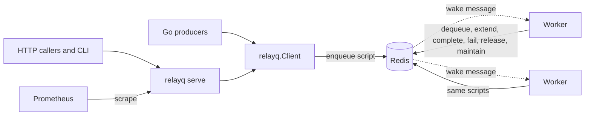
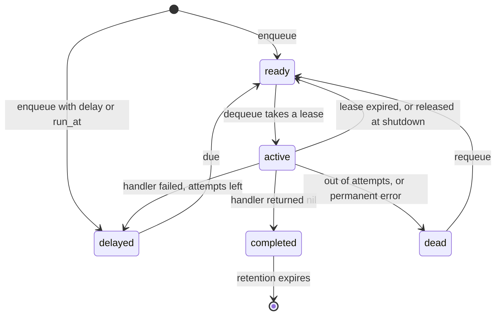

# relayq

A background job queue for Go, backed by Redis. You enqueue a job from Go or over
HTTP, and worker processes run it. If a worker dies mid job, another one gets the
job after a lease runs out. This is a personal project, built to find out what it
takes to make those words true, and the tests below try hard to make them false.

It has at-least-once delivery with visibility timeouts, retries with exponential
backoff and jitter, a dead letter queue, scheduled jobs, priorities, idempotency
keys, graceful shutdown, Prometheus metrics and a small CLI.

## Try it

The demo starts Redis with AOF on, the HTTP API, a producer and three workers. It
needs Docker.

```sh
docker compose up -d --build
docker compose exec -T api relayq stats
docker compose exec -T api relayq stats -queue demo
docker compose exec -T api relayq dead -queue demo
docker compose exec -T api relayq requeue -queue demo -all
```

To watch a redelivery, start a 15 second job, find the worker that holds it, and
kill that worker. The id before the first dash in `lease_owner` is the container.

```sh
docker compose exec -T api relayq enqueue -queue demo -type video.encode
docker compose exec -T api relayq job -queue demo JOB_ID
docker kill --signal KILL CONTAINER_ID
docker compose exec -T api relayq job -queue demo JOB_ID
```

In one run the worker was killed at 07:55:53.1. The job came back on another worker
at 07:55:56.9, when the lease ran out, and finished with `"delivery": 2` and a
`last_error` naming the dead worker. A `docker stop` on a worker instead lets the job
finish first: the worker logged `waiting for handlers to finish`, then `video encoded`,
and exited 0.

Remove everything afterwards with `docker compose down -v`.

## Use it from Go

Shortened from [examples/quickstart](examples/quickstart/main.go), which runs against
a local Redis with `go run ./examples/quickstart`:

```go
rdb := redis.NewClient(&redis.Options{Addr: "127.0.0.1:6379", ContextTimeoutEnabled: true})
client := relayq.NewClient(rdb)

worker, err := relayq.NewWorker(client, relayq.WorkerConfig{Queue: "emails"})
if err != nil {
	log.Fatal(err)
}
worker.Handle("welcome", func(_ context.Context, job *relayq.Job) error {
	var p struct{ To string }
	if err := job.Decode(&p); err != nil {
		return relayq.Permanent(err) // retrying cannot fix a bad payload
	}
	// Delivery is at least once, so this must be safe to run twice.
	fmt.Printf("welcome %s (job %s, attempt %d)\n", p.To, job.ID, job.Attempt)
	return nil
})

_, err = client.EnqueueJSON(ctx, "emails", "welcome", map[string]string{"to": "ada"},
	relayq.Priority(9),
	relayq.MaxAttempts(3),
	relayq.IdempotencyKey("welcome-ada"),
)
```

`worker.Run(ctx)` blocks. Cancelling `ctx` starts the graceful shutdown. Other
options are `relayq.Delay`, `relayq.RunAt`, `relayq.Timeout` and `relayq.WithBackoff`.
Handler contexts carry the reason they ended: `context.Cause` gives `ErrJobTimeout`,
`ErrLeaseLost` or `ErrShuttingDown`.

## HTTP API

`relayq serve` listens on `127.0.0.1:8080` by default. See
[.env.example](.env.example) for its settings. When `RELAYQ_API_TOKEN` is set, every
`/v1` route needs it as a bearer token. `/healthz` and `/metrics` stay open, so do
not expose the port to anyone who should not see queue names.

| Method and path | Purpose |
| --- | --- |
| `POST /v1/queues/{queue}/jobs` | Enqueue. 201 for a new job, 200 for a duplicate |
| `GET /v1/queues/{queue}/jobs?state=dead&limit=50&offset=0` | List jobs in a state |
| `GET /v1/queues/{queue}/jobs/{id}` | One job |
| `DELETE /v1/queues/{queue}/jobs/{id}` | Delete, or 409 if a worker holds it |
| `GET /v1/queues` | All queues with depths and counters |
| `GET /v1/queues/{queue}` | One queue |
| `POST /v1/queues/{queue}/dead/{id}/requeue` | Requeue one dead job |
| `POST /v1/queues/{queue}/dead/requeue` | Requeue all dead jobs |
| `GET /healthz` | 200 when Redis answers, else 503 |
| `GET /metrics` | Prometheus text format |

```sh
curl -i -X POST http://127.0.0.1:8080/v1/queues/demo/jobs \
  -d '{"type":"email.send","payload":{"to":"curl"},"delay":"2s"}'
```

Body fields are `type`, `payload`, `priority` (0 to 9, higher first), `max_attempts`,
`delay`, `run_at` (RFC 3339), `timeout`, `backoff_base`, `backoff_max`,
`idempotency_key` and `idempotency_ttl`. Durations are Go strings such as `90s`. The
key can also come from an `Idempotency-Key` header.

## CLI

`relayq` is a thin client for that API. Run `relayq help` for the list: `serve`,
`enqueue`, `job`, `jobs`, `stats`, `dead`, `requeue` and `delete`. It reads
`RELAYQ_SERVER` and `RELAYQ_API_TOKEN`.

```sh
go build -o bin/ ./cmd/relayq
./bin/relayq enqueue -queue demo -type email.send -payload '{"to":"cli"}' -priority 9 -idempotency-key k1
```

## Metrics

From `relayq serve`, read from Redis at scrape time, so they cover the whole fleet:
`relayq_queue_jobs{queue,state}`, `relayq_jobs_total{queue,event}` and
`relayq_redis_up`. The events are enqueued, deduplicated, delivered, completed,
failed, retried, redelivered, released, dead, requeued and deleted.

From each worker that sets `WorkerConfig.Registerer`:
`relayq_worker_handler_duration_seconds{type,outcome}`,
`relayq_worker_jobs_in_flight`, `relayq_worker_leases_lost_total` and
`relayq_worker_handler_panics_total`.

## How it is built



Each queue is five sorted sets, one per state, plus one hash per job. A job moves
between states only inside a Lua script, so Redis runs each move as one atomic step.



These decisions carry the guarantees:

- **Pop and lease are one script.** There is no moment where a job is in neither
  `ready` nor `active`, so no crash can drop it there.
- **Redis `TIME` is the only clock.** Leases and delays are computed inside scripts,
  so skew between worker machines cannot expire a lease early.
- **Every delivery gets a token.** `Job.Delivery` rises by one on each delivery and
  never resets. Complete, fail, release and extend all check it, so a stalled worker
  that wakes up late cannot change a job that has moved on.
- **Attempts are counted at delivery, not on failure.** A job that crashes its worker
  still runs out of attempts instead of killing workers forever.
- **Any worker can run maintenance.** Promoting due jobs and reclaiming expired leases
  is a script that moves each job once, so there is no leader to elect or lose.
- **Wake messages only lower latency.** Enqueue publishes on a channel that idle
  workers listen to. A lost message costs at most `PollInterval`.

Priority is the high bits of the sorted set score and a sequence number is the low
bits, so one `ZPOPMIN` gives strict priority with FIFO order inside a priority.

## Delivery guarantees

**What is guaranteed.** If `Enqueue` returns nil and Redis does not lose the write,
the job stays in Redis until one of these happens: a handler returns nil and the ack
reaches Redis, it lands in the dead letter queue after `max_attempts` deliveries, or
someone deletes it. relayq never drops a job on its own. This is at-least-once
delivery. It is not exactly-once, and no queue can run an arbitrary side effect
exactly once.

**A job can run more than once when:**

1. A worker dies after the side effect and before the ack reaches Redis. relayq
   cannot tell this from a crash before the side effect, so it must run the job again.
2. A lease expires while the handler is still running, because the worker froze or
   lost Redis for longer than `LeaseDuration`. Both handlers can then run at the same
   time. The old one gets `ErrLeaseLost` on its context, but Go cannot stop a goroutine
   that ignores it. Its result is refused.
3. A handler passes its job timeout and ignores cancellation. Heartbeats stop for it,
   the lease expires and the job runs elsewhere.
4. A handler ignores cancellation until the shutdown budget is gone. The lease is
   released, `Run` returns `ErrJobsAbandoned`, and the job can run while that handler
   is still going.
5. The ack cannot reach Redis for a full lease period. The worker gives up retrying
   and the job is redelivered.
6. Redis loses an ack, through a restart from older data or a failover. The job goes
   back to `active` and is redelivered.
7. The clock on the Redis host jumps forward, which expires leases early.
8. A handler returns an error after doing part of its work. That is a normal retry.
9. A producer retries without an idempotency key, or after the key has expired. That
   creates a second job with a new id.

So handlers must be idempotent. Use `Job.ID` as a deduplication key, since it is the
same on every delivery. Use `Job.Delivery` as a fencing token if a downstream system
can reject older writers.

**A job can be lost when Redis loses it**, and relayq cannot prevent that:

- Redis restarts without the write, as measured in the table below.
- Redis evicts keys. Use `maxmemory-policy noeviction`. `relayq serve` warns otherwise.
- A failover promotes a replica that had not received the write. Replication is
  asynchronous, and relayq does not use `WAIT` or `WAITAOF`.

**Other edges worth knowing:**

- `Enqueue` returning an error does not mean the job was not stored. The reply can be
  lost after Redis ran the script. Retry with an idempotency key to stay safe.
- Idempotency keys deduplicate enqueues, not executions. They last 24 hours by default
  and belong to one queue. If Redis loses the key, the next enqueue creates a new job.
- An attempt can be used up without the handler running, if the reply to a dequeue is
  lost. The lease expires and the job comes back with one attempt fewer.
- A job released at shutdown gets its attempt back, so rolling restarts do not push
  jobs toward the dead letter queue. `Delivery` still rises.
- Order is not guaranteed across workers. Inside a priority, jobs start in the order
  they became ready, but they run concurrently and retries go to the back.

## What survives a Redis restart

`TestWhatSurvivesARedisRestart` leaves jobs in every state, restarts Redis, then counts
what is still there and in the same state. It also drains the survivors, to show they
still work: ready jobs run, leases left by the dead worker expire and redeliver, and
dead and delayed jobs stay put. Each row is a real restart of a real container.

| Persistence | Stopped with | Ready | Delayed | Active | Dead | Completed | Idempotency keys |
| --- | --- | --- | --- | --- | --- | --- | --- |
| AOF `always` | SIGTERM | 200/200 | 110/110 | 20/20 | 20/20 | 20/20 | 10/10 |
| AOF `always` | SIGKILL | 200/200 | 110/110 | 20/20 | 20/20 | 20/20 | 10/10 |
| AOF `everysec` | SIGTERM | 200/200 | 110/110 | 20/20 | 20/20 | 20/20 | 10/10 |
| AOF `everysec` | SIGKILL | 200/200 | 110/110 | 20/20 | 20/20 | 20/20 | 10/10 |
| RDB `save 3600 1` | SIGTERM | 200/200 | 110/110 | 20/20 | 20/20 | 20/20 | 10/10 |
| RDB, ready jobs written after the snapshot | SIGKILL | 0/200 | 110/110 | 20/20 | 20/20 | 20/20 | 10/10 |
| None | SIGTERM | 0/200 | 0/110 | 0/20 | 0/20 | 0/20 | 0/10 |
| None | SIGKILL | 0/200 | 0/110 | 0/20 | 0/20 | 0/20 | 0/10 |

These counts were identical in every run. Queue counters such as `completed` live in the
same Redis, so they survive or vanish with the jobs.

What these rows mean:

- AOF with `appendfsync always` is the only setting that fsyncs a write before the
  client hears about it. Its zero loss is asserted, so the test fails if it changes.
- AOF with `everysec` lost nothing here, because SIGKILL kills the process and not the
  kernel, and the write had already reached the kernel. It does not protect against
  power loss or a kernel crash, where up to about a second of writes can go. This test
  cannot show that case. Redis can also delay the write itself when the disk is slow.
- RDB loses everything since the last snapshot. The test takes a snapshot and writes
  200 ready jobs after it. All 200 are gone, and this exact loss is asserted.
- Leases survive as absolute deadlines. Time passes during an outage, so they may be
  expired when Redis returns. Those jobs are redelivered, which is correct.

## How it was tested

Everything below ran on the machine from the benchmark section with `-race`, against
real Redis 7.4 in Docker. The failure tests start real worker processes, which are also
built with `-race`, and kill them with SIGKILL (`TerminateProcess` on Windows). Workers
log each handler event to a file outside Redis, so the record of what ran survives
anything done to Redis.

```sh
go test -race -count=1 ./...
go test -race -count=1 -tags integration -timeout 5m ./...
go test -race -count=1 -tags failure -timeout 15m -v ./test/failure/
go run test/mutation/main.go
```

The integration and failure tests start their own Redis containers and remove them.

| Test | What it does | What happened, two full runs |
| --- | --- | --- |
| `TestKilledWorkerJobIsRedelivered` | SIGKILL a worker mid job, then start another | Same job id redelivered 2.0 s after the kill, which is the lease. 2 handler starts, 1 finish |
| `TestCrashBetweenSideEffectAndAckDuplicatesTheEffect` | Worker dies after its side effect, before the ack | The side effect ran twice, as documented |
| `TestPoisonJobEndsInDeadLetterQueue` | A job kills its worker on every delivery, with 3 attempts | 3 deliveries, then the dead letter queue |
| `TestChaosKillingWorkersLosesNoJob` | 20000 jobs, 6 worker processes, one killed about every 150 ms plus restart time until 80% are done | 37 and 36 workers killed, 260 and 257 leases redelivered, 0 lost, 0 and 3 duplicate finishes |
| `TestJobsSurviveRedisCrashWhileRunning` | SIGKILL Redis (AOF `always`) under load. Down about 4 s, longer than the 2 s lease | 1700 and 1103 jobs accepted, 0 lost, 13 and 15 enqueue errors retried with the same key, 0 and 4 duplicate finishes |
| `TestFrozenRedisFencesTheHandler` | `docker pause` on Redis while a handler runs | The worker cancelled its own handler with `ErrLeaseLost`. The job finished on delivery 2 |
| `TestManyConcurrentWorkersRunEachJobOnce` | 16 workers of 16 slots and 8 producers, 20000 jobs, no failures | Every job ran exactly once. This one asserts no duplicates |
| `TestRetriesUnderConcurrencyLoseNothing` | 8 workers, 4000 jobs, random failures and delays | Every job finished, and counters match the runs recorded by the handlers exactly |
| `TestStaleDeliveryCannotChangeTheJob` | A stale worker tries to complete, fail or release a job that moved on | All three refused, and the current holder is unaffected |
| `TestSIGTERMFinishesTheRunningJob` | Real SIGTERM with a 1.5 s job running, on Linux | The job finished on delivery 1 and the worker exited 0 |
| `TestSIGTERMReleasesAJobThatCannotFinish` | Real SIGTERM with a job that outlasts the shutdown budget, on Linux | Back in `ready` with its attempt refunded, without waiting for the 30 s lease |

The duplicates in those runs are case 1 from the list above, happening for real. Zero
lost is what these tests assert. The duplicate count is only reported, and it changes
from run to run, so read it as "it happens", not as a rate.

**Do the tests fail when they should?** `go run test/mutation/main.go` breaks one
guarantee at a time in the source, and requires a named test to fail. For example, it
turns the delivery token check off, stops counting attempts at delivery, and splits
dequeue into a read and a separate remove. All 10 mutants were caught, and the runner
prints the assertion that caught each one. Splitting dequeue fails with handlers running
jobs that had already run, which is the reason dequeue is one script.

The two SIGTERM tests need Unix signals, so they are not built on Windows. They ran on
Linux in a container against the demo Redis, with this command from the repository root:

```sh
docker compose up -d redis
docker run --rm -v "${PWD}:/src" -w /src --network relayq-demo_default -e RELAYQ_TEST_REDIS_ADDR=redis:6379 golang:1.27.3 go test -race -count=1 -tags failure -run SIGTERM -v ./test/failure/
docker compose down -v
```

The same image also ran the integration suite. CI is set up to run all of this on Linux,
along with `golangci-lint`, `govulncheck`, `gofmt` and `go mod tidy -diff`.

## Benchmark

Measured on 2026-11-05 on one machine:

- Intel Core i5-10400T (6 cores, 12 threads, 2.0 GHz base), 16 GB RAM, Windows 11.
- Docker Desktop, engine 29.7.2, Linux VM with 12 CPUs and 7.7 GiB.
- Redis 7.4.12 in a container, AOF on with `appendfsync everysec`.
- Go 1.27.3. `relayq-bench` ran in a second container on the same Docker network, so
  the load generator and Redis shared the machine.
- 128 byte payloads and no-op handlers, so this is queue overhead and not useful work.

```sh
docker compose up -d redis
docker compose --profile bench run --rm -T bench -scenario process -jobs 100000 -workers 4 -concurrency 32
docker compose down -v
```

Each row is the median of 5 runs. The flags below replace the ones in the command above.

| Scenario | Flags | Median jobs/s | Min to max | Latency |
| --- | --- | --- | --- | --- |
| Enqueue one at a time | `-scenario enqueue -jobs 100000 -producers 16` | 7637 | 6682 to 9737 | per call p50 1.7 ms, p99 6.9 ms |
| Enqueue in batches of 100 | `-scenario enqueue -jobs 200000 -producers 4 -batch 100` | 17774 | 12186 to 23092 | per batch p50 19 ms, p99 53 ms |
| Process a full queue | `-scenario process -jobs 100000 -workers 4 -concurrency 32` | 4096 | 3984 to 6167 | not measured |
| Produce and process together | `-scenario e2e -jobs 100000 -producers 8 -workers 4 -concurrency 32` | 3571 | 2303 to 3647 | enqueue to handler start p50 2.5 ms, p99 7.0 ms |
| Fixed rate of 1000 jobs/s | `-scenario e2e -jobs 30000 -producers 4 -workers 4 -concurrency 32 -rate 1000` | 1000 | 1000 to 1000 | enqueue to handler start p50 1.8 ms, p99 16 ms |

Latency in the fixed rate row moved a lot between runs: p99 was 3.1 ms at best and
18.5 ms at worst. A run is rejected unless Redis counts exactly as many deliveries and
completions as jobs sent, with nothing left over, so a job counts only once its ack
has landed.

**Why processing is slower than it looks like it should be.** The first result was low
enough to check. A 20000 job run came in at 8185 jobs/s, twice the 100000 job rate, and
`aof_rewrites` went from 1 to 16 over five long runs. Each job writes several commands to
the AOF, so long runs keep passing the 64 MB rewrite threshold, and each rewrite forks
Redis. Changing only the persistence settings shows the cost, as the median of 3 runs of
`-scenario process -jobs 100000`:

| Redis persistence | Median jobs/s |
| --- | --- |
| AOF off | 10525 |
| AOF `everysec`, automatic rewrite off | 7738 |
| AOF `everysec`, default automatic rewrite | 4096 |

The ceiling is the single Redis thread. `INFO commandstats` over that 20000 job run shows
about 103 microseconds of script time per job for its three scripts, which is close to
10000 jobs/s. Plain `SET` on the same server ran at 60642 per second with
`redis-benchmark`. These numbers describe this machine and are not a comparison with any
other queue.

## What it does not do

- **No Redis Cluster.** Scripts build job keys at run time, which Cluster does not
  allow across slots. It was tested on one Redis server only. Sentinel and failover
  were not tested, and the failover risks above apply.
- **No exactly-once delivery**, as explained above.
- **No recurring jobs.** There is no cron. Scheduling is one-shot.
- **Strict priority can starve.** A steady stream of priority 9 jobs keeps priority 0
  jobs waiting forever. There is no aging.
- **One queue per `Worker`.** Run several workers in a process to serve several queues.
- **Go cannot kill a handler.** One that ignores its context keeps its concurrency
  slot until the process exits.
- **Dead jobs stay until you act.** They are kept forever and use Redis memory.
- **No per-tenant auth.** The API has one optional shared token and no TLS. Put it
  behind something that terminates TLS if it leaves localhost.
- **Payloads live in Redis.** The API caps a request body at 1 MiB. The Go client does
  not cap payloads.
- **Delayed jobs need a worker.** Due jobs are promoted by worker maintenance, every
  500ms by default, so a scheduled job can start that much late, and not at all while
  no worker is running.

## License

MIT
